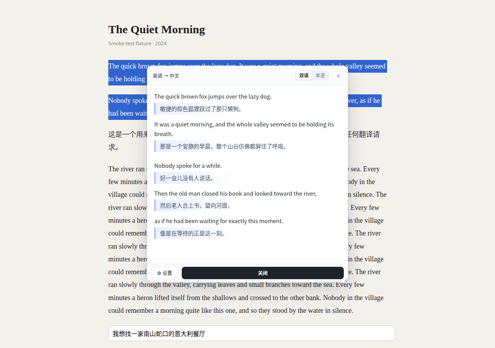
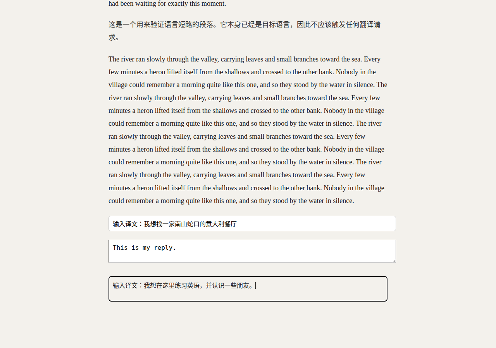
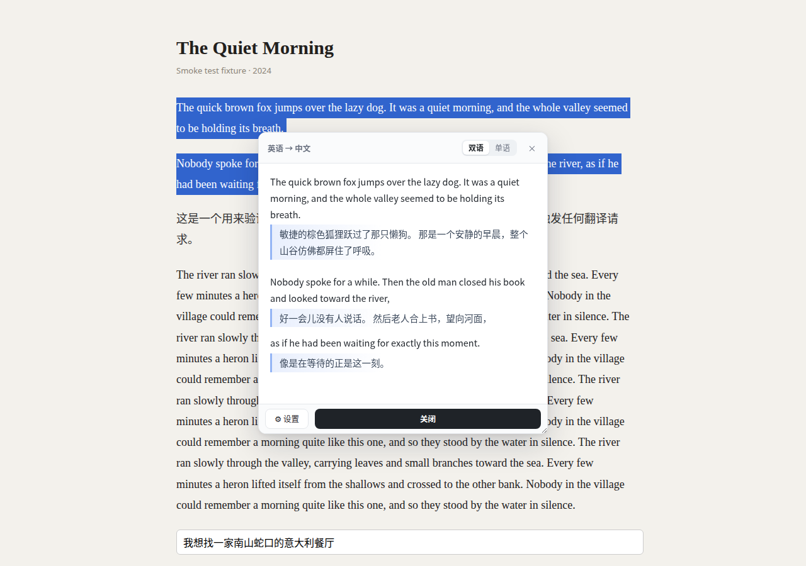
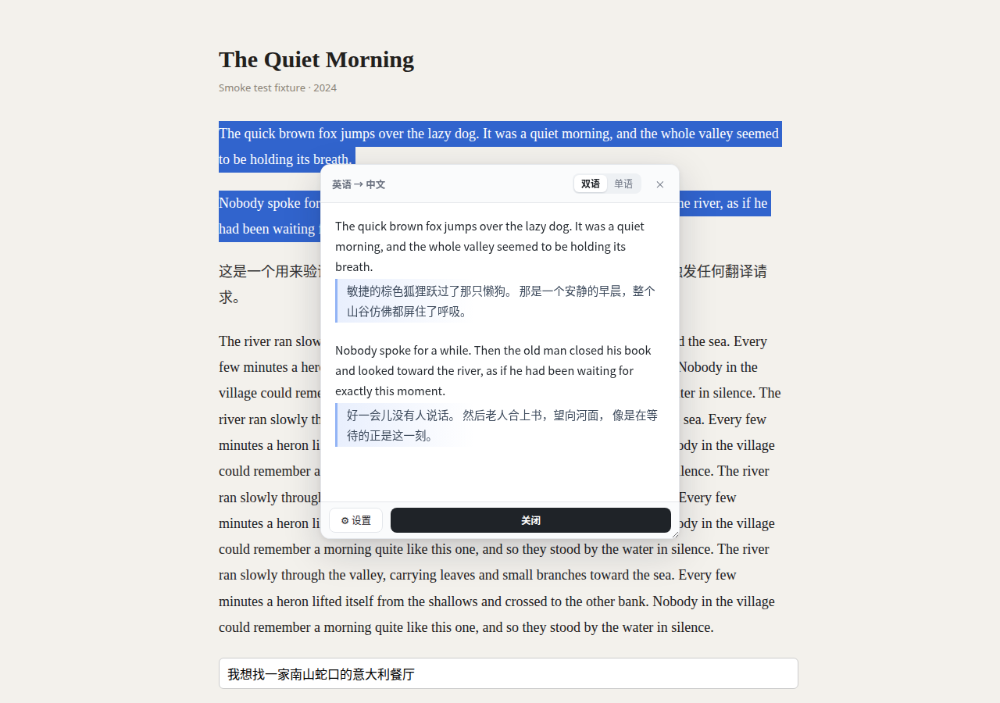

# 划词翻译 · Selection Translator

[English](./README.en.md) | 简体中文

[](https://github.com/seeyouyousee/selection-translator/actions/workflows/ci.yml)

一个 Chrome MV3 扩展：**选中网页文字 → 点“翻译” → 自动弹出对照窗口**，面向精读学习；也能把输入框里写好的文字翻译后原位替换。

> A Chrome MV3 extension: unit-by-unit bilingual reading on any page, and in-place translation of what you type in an input box. One request per action, no retries.

- **双语对照**逐单元排：一句原文 → 它自己的译文 → 下一单元，段落只作分组与留白。
- **一次请求**：原文只发一次，句间用 `[[n]]` 标记表达切分；模型把整段当**完整段落**翻译，切分不合理时可丢掉标记合并相邻两块，代码按标记还原对照。
- **单语**：只显示目标语言译文。
- **输入框翻译**：在搜索框 / 回复框 / 可编辑区域里**选中自己写的文字** → 点「译」→ 用译文**原位替换**（`Ctrl+Z` 可撤销）。
- 目标语言可设置；选区本身已经是目标语言时**不调用 API**，直接单语显示原文，忽略模式选择。
- 一次翻译结果同时适配两种模式：窗口里切换**只重排、不重新翻译**。

## 截图

| 双语逐单元对照 | 输入框原位替换 |
|---|---|
|  |  |

模型觉得切分不合理时，可以丢掉标记合并相邻两块（仍然一次请求）：



标记不自洽时整段降级（仍然一次请求）：



## 安装

```bash
pnpm install
pnpm build          # 产物在 dist/
```

1. Chrome 打开 `chrome://extensions`
2. 右上角开启 **开发者模式**
3. 点 **加载已解压的扩展程序**，选择本仓库的 `dist/` 目录
4. 首次安装会自动打开设置页

> `src/` 不能直接加载，扩展是 `dist/` 里的构建产物。

## 配置

设置页（首次安装自动打开；之后点工具栏图标或扩展详情里的“扩展程序选项”）：

| 项 | 说明 |
|---|---|
| Base URL | 任意 OpenAI 兼容端点，如 `https://api.deepseek.com/v1`、`https://api.openai.com/v1` |
| API Key | 存在 `chrome.storage.local`，只由后台 service worker 使用，不下发给页面 |
| 模型 | 如 `deepseek-chat`、`gpt-4o-mini` |
| 阅读目标语言 | 选中网页文字时翻成的语言，默认中文 |
| 输入目标语言 | 输入框里选中文字时翻成的语言，默认英语 |
| 关闭模型思考 | 默认开启：请求里显式发送关闭思考参数；网关报错会自动去掉并记住 |
| 默认展示模式 | 双语 / 单语（窗口里切换会同步成新的默认） |
| 窗口大小 | 小 420×420 / 中 520×560 / 大 680×720；手动拖拽后的尺寸优先 |
| 测试连接 | 请求 `/models` 探测端点与 Key |

## 使用

1. 在网页上选中一段文字 → 选区旁浮出「译 翻译」
2. 点击 → 浮钮收起，**窗口自动弹出**（先 loading，再出结果）
3. 顶部「双语 / 单语」切换：同一份结果即时重排，不会重新请求
4. 拖动标题栏移动窗口；拖右下角调整大小；尺寸与位置会被记住
5. 关闭：底部操作栏的 **「关闭」**、右上角 `×`、或 `Esc`；**点窗口外不会关**

### 输入框翻译

1. 在搜索框、回复框或 `contenteditable` 区域里写内容；
2. **选中要翻译的那段文字** → 选区旁浮出「译」；
3. 点击 → 按钮变成「翻译中…」→ 完成后**用译文替换选中的文字**；
4. 替换成功时**静默完成**，不弹提示；只有失败或“已是目标语言”才在底部提示。`Ctrl+Z` 可撤销替换。

窗口底部有一条常驻操作栏：

```
⚙ 设置                                 关闭
```

- **设置**：随时打开扩展设置页（不用再去工具栏找图标）；
- **关闭**：看完直接点，按钮在底部右手边，比右上角的小 × 好点；
- 右上角的 × 也放大到了 32px，仍是快捷入口。

**设置页的入口**（关掉之后随时能回来）：

| 入口 | 操作 |
|---|---|
| 翻译窗口底栏 | 点「⚙ 设置」 |
| 工具栏图标 | 左键单击（建议把扩展图标固定到工具栏） |
| 工具栏图标 | 右键 →「划词翻译设置」 |

选区先按 DOM 段落分组，段内用规则切好单元，然后把单元用编号标记串回**一段原文**（`unit0 [[0]] unit1 [[1]] …`）发给模型——原文只发一次，不重复。模型被明确告知「这是一个完整段落，整体翻译」，并可以丢掉某个标记来合并相邻两块。回来后按标记切分译文；标记必须自洽（有序、不越界、不重复、每片非空），**不自洽就把整段当作一个整体**，不报错、不重试。全程只有一次 API 请求。规则切分同时用于「已是目标语言」时的本地展示（不调 API）。

**关闭思考（默认开启）**：请求里显式发送 `reasoning_effort: "none"`、`enable_thinking: false`、`thinking: {"type": "disabled"}`。如果网关不认识这些参数而返回 400，会自动去掉、重试一次并记住，之后不再发。可在设置页关掉这个行为。

## 隐私

- API Key 与设置只存在本机 `chrome.storage.local`，不会上传到任何第三方；
- 只有你**主动触发**翻译时，选中的网页文字 / 输入框里的文字才会发送到**你自己配置的** OpenAI 兼容端点；
- 不采集页面内容、不做统计、不写远端日志；
- 缓存只在 `chrome.storage.session`，关闭浏览器即清空。

## 开发

```bash
pnpm install
pnpm build        # 打包到 dist/
pnpm watch        # 监听重建
pnpm typecheck    # tsc --noEmit
pnpm test         # vitest：语言检测 / 分块 / 标记解析（50 项）
pnpm smoke        # 真机冒烟：Chromium 加载 dist + 本地 mock LLM，跑完整链路并截图
pnpm timing       # 计时诊断（DELAY=1500 pnpm timing 模拟模型耗时）
```

冒烟脚本需要 Chromium。**Chrome 品牌版从 137 起硬禁 `--load-extension`**（二进制里直接打印 “not allowed in Google Chrome, ignoring”），所以 `pnpm smoke` 默认找 Playwright 自带的 Chromium；可用 `CHROME_PATH=/path/to/chrome pnpm smoke` 覆盖。

冒烟输出在 `test/smoke/out/`：`bilingual.png`、`mono.png`、`same-language.png`、`long-scroll.png`、`restored-size.png`、`merged.png`、`whole-paragraph.png`，以及 `run.log`。共 11 个场景，除了截图断言，还会检查：译文在原文下方、译文有 3px 左标线、窗口尺寸等于预设、长内容出现内部滚动、手动尺寸与模式能被记住、**底栏「设置」能新开设置页**、**× 放大到 ≥30px**、**底栏「关闭」能关窗**、**丢标记=合并**、**标记不自洽时整段降级**、**输入框与 contenteditable 的选中翻译与原位替换**，且都断言只发一次请求。

排查耗时：`chrome://extensions` → 该扩展的「服务工作进程」→「检查视图」→ Console，每次翻译打印一行 `[st] one-call xxxms blocks=N units=N`。

## 关键设计

| 决策 | 原因 |
|---|---|
| 原文只发一次 + 标记表达切分 | 不重复发原文（不再有 `units` 数组），输入最小；标记是唯一的切分信源 |
| 一次请求，无重试无兜底 | 速度是硬指标；标记不自洽只降级展示，绝不追加请求 |
| 标记自洽校验 | 有序 / 不越界 / 不重复 / 每片非空；不满足就整段作为一个整体 |
| 模型可丢标记合并 | 本地切分不理想时，让模型用「丢标记」表达合并，语义更自然 |
| 一次调用返回单元级 `{src, tgt}` | 双语 = 逐单元交错；单语 = 段内拼回段落。切模式零成本 |
| 本地语言检测短路 | 已是目标语言就别花 API 的钱和时间 |
| 缺段/数量不符直接报错 | 宁可显示错误让用户重试，也不静默错位 |
| `response_format=json_object`，400 时自动退回 | 兼容不认这个参数的网关 |
| 429/5xx 退避重试一次 | 上游抖动不该让用户手动重试 |
| `chrome.storage.session` LRU 缓存 | 重复选中同一段直接出结果，关浏览器即清 |
| Shadow DOM + 固定定位宿主 | 站点样式进不来，也不改动页面正文 |

## 已知边界

- 只处理主框架（`all_frames: false`），不处理 iframe 内选区
- 语言识别是启发式：**判不准时宁可翻译**，不会把外文误当原文直接展示
- 标记是软约束：模型可能全丢（→ 整段一对）或全留（→ 本地粒度），都不会多打请求
- 本地切分决定粒度上限：模型只能合并、不能切得更细
- 规则切分：`Intl.Segmenter` 切句 + 长句按标点细分；没有任何标点的长句切不动
- 输入框翻译只覆盖 `input[type=text/search/email/url/tel]`、`textarea`、`contenteditable`；密码/银行卡字段不碰
- iframe 里的输入框暂不支持（`all_frames: false`）
- 单次上限 8000 字 / 200 段，超出只提示、不发请求
- v1 不做流式输出（结构化块排版不适合增量渲染）
- 缓存只在会话内，浏览器关闭即清空

## 目录

```
src/
  manifest.json          MV3 清单
  entries/content.ts     内容脚本入口：选区监听 / 浮钮 / 窗口接线
  entries/background.ts  service worker：唯一出网点（API / 解析 / 缓存）
  content/extract.ts     选区 → 段落块（DOM 结构优先，纯文本兜底）
  content/segment.ts     本地规则切分（决定对照粒度；同语言展示也用它）
  content/ui/            浮钮、翻译窗口、Shadow DOM 样式
  options/               设置页
  shared/                类型、语言检测、结果解析、设置、消息协议
build/build.mjs          esbuild 打包（IIFE、零运行时依赖）
test/                    vitest 单测 + Chromium 冒烟
```

## 贡献

见 [CONTRIBUTING.md](./CONTRIBUTING.md)。改动前请先读 [REQUIREMENTS.md](./REQUIREMENTS.md)，里面写死了几条不能破坏的约束。

## 许可证

[MIT](./LICENSE)
